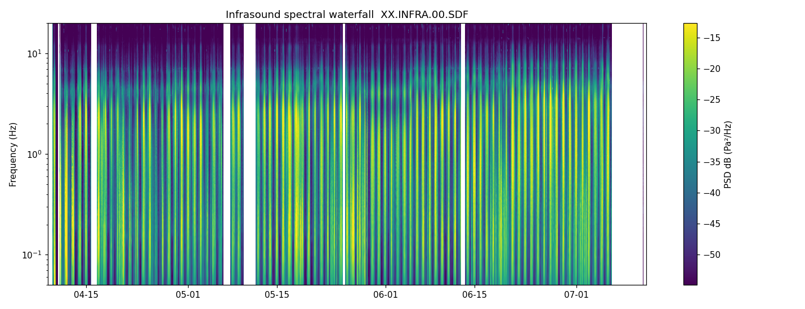

# infrasound-monitor

### 🌊 [**Live dashboard → infra.tail4c32e5.ts.net**](https://infra.tail4c32e5.ts.net/)

Rebuilt daily at 06:15 Pacific on the station's Raspberry Pi and served from it over
Tailscale Funnel: spectral waterfall, long-term noise (PDF-PSD), data availability, a
night-only persistent-tone hunt for datacenter noise, and a wind-matched change monitor.

---

Acquire, convert, and visualize [Infiltec INFRA20](https://www.infiltec.com/Infrasound@home/)
infrasound data using **standard seismological formats** (miniSEED + StationXML),
so the data is compatible out-of-the-box with ObsPy, Swarm, PQLX, and the wider
FDSN/Raspberry Shake toolchain.

This replaces [AmaSeis](https://www.iris.edu/hq/) for infrasound use: AmaSeis stores
data in a nonstandard hourly `.Z` format with no embedded calibration. Here the data
is calibrated, self-describing, and portable.

> **Setting it up on your own machine?** See **[DEPLOY.md](DEPLOY.md)**: a Raspberry Pi
> (`deploy/setup.sh`), which runs everything including the nightly analysis even with
> 1 GB. Optionally, an always-on server can pull the archive as a snapshotted backup
> ([deploy/truenas/README.md](deploy/truenas/README.md)).

## Why these formats

- **miniSEED** is the FDSN standard for geophysical time series, including pressure/
  infrasound. Samples are stored as raw integer **counts** (Steim2-compressed, ~56% of
  the AmaSeis size), and the counts→Pascals calibration lives in the metadata — the
  same convention used by Raspberry Boom and professional infrasound arrays.
- **StationXML** carries the sensor identity and the `1000 counts/Pa` INFRA20 response,
  so any tool can convert to Pascals (`tr.remove_sensitivity(inv)`).
- Channel code **`SDF`** = `S` short-period (10–80 sps) · `D` pressure sensor ·
  `F` infrasound ([FDSN source identifiers](https://docs.fdsn.org/projects/source-identifiers/)).

## Install

```bash
pip install -e .
```

## Usage

### 1. Convert existing AmaSeis data → miniSEED archive (Phase 1)

```bash
infra-convert ~/AmaSeis ~/infra-archive \
    --network XX --station INFRA --location 00
```

Writes a SeisComP Data Structure (SDS) archive plus `station.xml`:

```
infra-archive/
  station.xml
  2026/XX/INFRA/SDF.D/XX.INFRA.00.SDF.D.2026.<julday>
```

Consecutive hours are merged into gap-free, single-rate traces; missing hours become
explicit gaps. (AmaSeis only bins to the hour, so within a run sample times may differ
from wall-clock by <~0.3 s — negligible for infrasound.)

### 2. Spectral waterfall over a date range (Phase 2 — primary display)

```bash
infra-waterfall ~/infra-archive \
    --start 2026-04-09 --end 2026-07-12 \
    --out waterfall.html --cache grid.npz
```

Produces a **self-contained interactive HTML** (open in any browser, no server): time ×
frequency, PSD in dB (Pa²/Hz). `--cache` stores the hourly PSD grid so re-rendering is
instant. That's two files, `grid.npz` (times, frequencies) and `grid.psd.f32` (float32
rows, memory-mapped on load and appended to in place). Rendering the waterfall and
dashboard from it streams over the rows, so memory stays flat as the record grows. This is the display for **before/after comparison** (e.g. a datacenter appearing
as a new persistent horizontal line).

Drag on the plot to zoom into a date range, use the **range slider** under the x axis to
scroll along a long record, and double-click to reset. So that the page stays openable as
the archive grows, the time axis is capped at `--max-cols` columns (default 3000 ≈ 4
months hourly); beyond that, consecutive hours are median-combined into wider bins — a
median in power, so a single transient can't brighten a whole bin while a persistent tone
survives. `--max-cols 0` keeps hourly resolution at any length, at the cost of a page that
grows without bound (~78 MB and ~1.3 GB peak RAM to render 3 years, vs ~13 MB and ~220 MB
capped).



The diurnal (day/night) cycle shows as vertical banding; data gaps are blank columns; a
persistent narrowband source would appear as a horizontal line.

### 3. Live acquisition from the INFRA20 serial port

```bash
infra-acquire /dev/ttyUSB0 ~/infra-archive
```

Reads the INFRA20's serial stream (**9600 8N1, one signed integer count per
CRLF line, ~51.4 sps** — confirmed against hardware) and appends 5-minute segments to
the SDS day files, splitting automatically at UTC midnight and (re)writing
`station.xml`. A genuine serial dropout leaves an explicit gap; a USB glitch triggers
reconnect. Only one program can hold the port, so **close AmaSeis first** — this
replaces it.

**Timing.** The sensor's sample clock free-runs: about 51.42 sps on average, but it
wanders by ~3e-4 within hours, i.e. seconds a day. A reader thread stamps every sample
with the system clock as it arrives, so a slow disk can't delay the stamps. The writer
estimates when each sample was taken from the earliest arrivals. Everything is written
at the one configured `sample_rate`, so `Stream.merge` works on any stretch. Whenever
the archive's clock drifts 1 s from UTC (NTP), the next segment starts at the true time:
a logged "timing correction", about 8 a day, each under a second, with no samples lost.
The flush lines in `journalctl -u infra-acquire` show the sensor's measured rate; set
`sample_rate` to its long-run mean. Archives recorded before 2026-11 contain false 2 s
breaks from the old clock model (no samples are missing). The analysis reads across
breaks shorter than 2.5 s rather than zero-filling them (`waveforms.py`).

```bash
infra-acquire /dev/ttyUSB0 --sniff          # just print raw lines to eyeball the framing
```

**Live drum view (AmaSeis-style).** The port is exclusive, so a live viewer can't
also read it. Run the daemon with `--live-file <local.npz>` and it mirrors the last
few minutes of raw samples to that local file; `tools/live.py` tails it and renders a
scrolling helicorder that updates ~once a second — without interrupting archiving:

```bash
infra-acquire /dev/ttyUSB0 ~/infra-archive --live-file ~/live.npz
python tools/live.py --live-file ~/live.npz    # live window; --snapshot x.png for one frame
```

### 4. Helicorder / drum view (Phase 3 — optional)

```bash
infra-helicorder ~/infra-archive 2026-07-01 --out day.png
```

The classic drum-recorder view AmaSeis emulated. Note **Swarm** (load the archive) and
ObsPy already provide interactive helicorder + spectrogram views, so a bespoke raw-data
UI may be unnecessary.

### Use the data in other tools

```python
from obspy import read, read_inventory
st  = read("infra-archive/2026/XX/INFRA/SDF.D/XX.INFRA.00.SDF.D.2026.182")
inv = read_inventory("infra-archive/station.xml")
st.remove_sensitivity(inv)   # counts -> Pascals
st.spectrogram()             # or st.plot(type="dayplot")
```

Or point **Swarm** / a **SeedLink**/**FDSNWS** server at the SDS archive.

For a ready-made standard-tools analysis, `tools/analyze.py` builds a calibrated
**PPSD** (McNamara–Buland, `special_handling="hydrophone"` for the flat pressure
response) plus an optional calibrated dayplot, and reports whether any persistent
narrowband tone stands out above the background — the datacenter test:

```bash
python tools/analyze.py ~/infra-archive \
    --start 2026-04-09 --end 2026-07-12 --dayplot 2026-07-01
```

PSD is pressure (Pa²/Hz), so it sets `db_bins` for pressure, not ObsPy's seismic
default (which would clip pressure PSD at its −50 dB top bin). The PPSD is drawn with
the station's own 10/50/90th-percentile noise envelope (the before/after reference);
published **global infrasound noise models** (Bowman 2005; Brown 2014) can be overlaid
with `--noise-model curves.csv` once digitized (see `tools/noise_models/`).

To hunt specifically for a **persistent narrowband tone over many days** (the
datacenter signature), `tools/tonehunt.py` renders a *tone-enhanced* waterfall: it
subtracts each hour's smooth spectral baseline so the day/night cycle and broadband
energy drop out and any steady tone appears as a bright horizontal line. It also
prints the most-persistent frequencies (>~50 % of hours at a fixed frequency = a
real tone).

```bash
python tools/tonehunt.py ~/infra-archive \
    --start 2026-04-09 --end 2026-07-12 --cache grid.npz   # reuse the waterfall's grid cache
```

Add `--night` to restrict to the quietest pre-dawn hours (auto-detected from the
diurnal cycle — no timezone assumptions). A datacenter runs 24/7 but the ambient
background drops at night, so a steady tone stands out far more; the night view
renders a nightly-mean waterfall and ranks frequencies **more persistent at night
than day** (the datacenter-like signature).

```bash
python tools/tonehunt.py ~/infra-archive --start ... --end ... \
    --cache grid.npz --night
```

**Tone tracker.** Scoring each frequency bin on its own undercounts a real machine tone,
which wanders a few hundredths of a Hz and so spreads over neighbouring bins.
`tools/tonetrack.py` instead finds every hour's narrowband peaks, links them hour to hour
into tracks that follow a tone as it drifts, and groups the tracks into **sources**. Each
source gets its frequency range, how often it's present (baseline vs the recent window),
its local hour-of-day and weekday schedule, and its harmonics. Sources listed under
`[[tones.known]]` in `config.toml` are labelled. The verdict flags an **unexplained steady**
source: present in most recent hours, around the clock, and neither known nor a harmonic. A
known source that *turns* steady is flagged too, since a new machine can sit at a known
frequency. It runs on the grid in about a minute on a Pi 3B+, and the dashboard shows it.

```bash
python tools/tonetrack.py --png tones.png --csv sources.csv
```

For a one-page **station quality + noise report** (an ISPAQ/MUSTANG-style summary —
ISPAQ itself is Linux/R-only), `tools/report.py` emits a self-contained HTML with
station metadata, data availability/uptime and gaps, the **PDF-PSD** (probability
density of hourly PSD, with 10/50/90th percentiles), per-band noise levels (Pa and
dB SPL), and the persistent-tone verdict — all from the cached grid, in seconds:

```bash
python tools/report.py ~/infra-archive \
    --start 2026-04-09 --end 2026-07-12 --cache grid.npz
```

`tools/dashboard.py` combines everything into a single public **monitoring dashboard**
(`analysis/index.html`) — a self-contained, static page with summary KPIs, the night
tone-hunt verdict, the waterfall, PDF-PSD, and availability, all images embedded. It's
designed to publish as-is to a static host (GitHub Pages / Netlify / S3); regenerate it
on a schedule to keep it current:

```bash
python tools/dashboard.py ~/infra-archive \
    --start 2026-04-09 --end 2026-07-12 --cache grid.npz
```

### Before/after: the wind-matched change monitor

Wind is the largest cause of level changes at a home station, so a datacenter's
contribution can only be judged at equal wind. `infra-weather` fetches observations from
nearby airport stations (the [Iowa Environmental Mesonet](https://mesonet.agron.iastate.edu/)
ASOS archive, free, no key): 1-minute wind and gusts where the station has them, plus
METARs and 5-minute reports. It stores them as CSV in `<archive>/weather/`, so archive
backups carry them. Set the stations in `config.toml`, then backfill once; the nightly
rebuild keeps them current.

```bash
infra-weather --start 2026-04-01          # stations from [weather] in config.toml
python tools/compare.py                   # night hours, last 14 days vs everything before
python tools/compare.py --change-date 2027-01-15 --hours all --png change.png
```

`tools/compare.py` learns, from the "before" hours, the level each octave band had at
each wind speed (0.125–16 Hz bands, dB SPL), measures every "after" hour against that at
its own wind, and reports the median change per band. The 90% interval comes from
resampling whole nights. Rainy hours are left out. Set `[analysis] change_date` when the
datacenter starts; until then it compares the most recent `recent_days` with the rest,
which checks that the baseline is stable. The dashboard shows the same comparison.
Seasonal sources still show (ocean microbaroms grow from September and lift the lowest
bands), so read those with the calendar in mind.

`tools/transients.py` is an **infrasound event explorer**: it detects transients
(STA/LTA over a 2–15 Hz band), **characterizes** each (duration, spectral centroid,
bandwidth, tonality, frequency drift), **classifies** them (tonal / rumble / glide /
burst — heuristic), and writes a browsable **HTML catalog** (timeline coloured by class,
class breakdown, and a table of notable events with thumbnail spectrograms) plus a CSV.
Most useful at a quiet outdoor site. The natural next step is **attribution** —
correlating event times with public **train schedules** (GTFS) and **ADS-B flight
tracks** (e.g. the OpenSky API) to positively identify sources.

```bash
python tools/transients.py ~/infra-archive \
    --start 2026-06-01 --end 2026-06-22 --html events/index.html --csv events.csv --top 24
```

## Status

- [x] Acquire → convert → analyze pipeline (miniSEED SDS + StationXML), config-driven
- [x] Live acquisition daemon (`infra-acquire`) — framing hardware-verified; auto-start service
- [x] AmaSeis-style live drum viewer (`tools/live.py`)
- [x] Analysis — spectral waterfall, PPSD, station report, night tone-hunt, event explorer
- [x] Public, auto-updating dashboard, rebuilt and served by a 1 GB Pi in flat memory
- [x] Turnkey deploy: Raspberry Pi/systemd (`DEPLOY.md`, `deploy/`, `tools/doctor.py`),
      and a TrueNAS SCALE job that pulls the archive as a backup (`deploy/truenas/`)
- [x] Tone tracker: drifting tones followed hour to hour, grouped into scheduled/steady sources
- [x] Wind-matched before/after comparison (`tools/compare.py`, airport weather via `infra-weather`)
- [x] Recorder clock tracks the sensor's wandering rate: no false gaps, archive time within ms of UTC
- [ ] G-weighting (ISO 7196) for health-threshold context
- [ ] Event attribution — correlate transients with train (GTFS) + aircraft (ADS-B) data
- [ ] Serve the live archive over SeedLink for real-time remote views
- [ ] Relocate the sensor to a quiet outdoor site (it moved to a quieter indoor spot on
      2026-08-04, and the published baseline starts there)

## Layout

```
src/infrasound_monitor/   package (console scripts: infra-convert/-acquire/-waterfall/-inventory/-weather)
  config.py      reads config.toml; constants, calibration, station identity
  amaseis.py     legacy .Z reader          convert.py    .Z -> miniSEED SDS archive
  metadata.py    StationXML / response     psd.py        archive -> hourly PSD grid (+ update)
  waterfall.py   grid -> interactive HTML  helicorder.py drum/dayplot
  waveforms.py   archive -> contiguous pieces (never zero-fills a break)
  weather.py     airport weather (IEM ASOS) -> <archive>/weather/*.csv -> hourly
  acquire.py     live serial acquisition daemon (config-driven; --sniff/--list/--live-file)
tools/           analyze.py (PPSD) · tonehunt.py (--night) · report.py · dashboard.py ·
                 compare.py (wind-matched before/after) · tonetrack.py (tone tracker) ·
                 transients.py (event explorer) · live.py (live drum) · refresh.py · doctor.py ·
                 tft_status.py (Raspberry Pi Mini PiTFT status display) ·
                 statusd.py (lightweight live-status web page) ·
                 sim_infra20.py (synthetic serial source for hardware-free testing)
deploy/          setup.sh (--dashboard/--display/--swap/--backup) + backup.sh
                 + *.service / *.timer  (systemd: acquire / dashboard / display / status / backup)
                 truenas/ pull.sh: a daily NAS cron job that pulls the archive as a backup
config.example.toml  copy to config.toml (git-ignored) and edit for your station
DEPLOY.md        deployment guide
```
